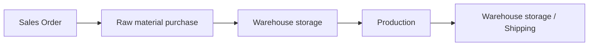

# ArchiBike: ERP Digitalization with Odoo, BPMN Process Modeling & TypeScript E-commerce Storefront

A simulated digital transformation of a European bicycle manufacturer: company structure modeled in **ArchiMate**, business processes designed in **BPMN 2.0** (Bizagi), end-to-end operations configured in the **Odoo ERP** (HR, Inventory, Manufacturing, Purchasing, Sales, CRM), plus a public **e-commerce storefront** built in **TypeScript** with React and TanStack Start.

🔗 **Live preview:** [preview--archibikeproject.lovable.app](https://preview--archibikeproject.lovable.app/)

---

## 📌 Overview

**ArchiBike** is a European company that assembles bicycles and manufactures some of its own components. The project simulates its digitalization with three goals:

* **Reduce the time** spent on day-to-day operations.
* **Increase sales**.
* **Give customers and employees a clear overview** of the company's processes and structure.

The work is organized in four layers:

1. **Enterprise Architecture**: company structure modeled in ArchiMate.
2. **Process Modeling**: BPMN diagrams for hiring, warehouse, production, purchasing, sales and CRM.
3. **ERP Implementation**: every department and process configured and simulated in Odoo.
4. **E-commerce Storefront**: a TypeScript website that presents the catalog online and turns visitors into sales and B2B requests.

---

## 🏢 Company Structure (ArchiMate)

| Unit | Location | Departments |
|---|---|---|
| **Headquarters (HQ)** | Rome | Accounting, Product Development, CRM |
| **Production Center (PC)** | Rome | Warehouse, Purchasing, Production |
| **Distribution Centers (DC) ×3** | France, Spain, Belgium | Warehouse, Sales, CRM |

* **HQ**: Accounting handles billing and customer master data. Product Development studies product design and customer change requests. CRM HQ coordinates the DC CRMs, manages customer financial data and feedback, and sets up sales teams.
* **Production Center**: the warehouse runs a **Make To Order (MTO)** policy. A new customer order triggers a production cycle, and Purchasing is notified when raw materials or semi-finished goods are missing.
* **Distribution Centers**: they receive finished products from the PC, handle incoming customer orders through Sales, and track deliveries for the customer through CRM.

In Odoo, the company, all **15 departments** (3 HQ + 3 PC + 3 per DC), the job positions and the employees were created, and each employee was linked to an Odoo user. The hiring process (CV screening → first interview → technical interview → hire or rejection) was modeled in BPMN.

---

## ⚙️ ERP Modules (Odoo)

### 1. Warehouse (Inventory)

* **Product master data**: 26 products, including finished goods (*Bicicletta*), kits (*Kit-Chassis, Kit-Ruota, Kit-Sella, Kit-Manubrio, Kit-Cambio*), components (chain, brakes, pedals, sprockets, rims, grips…) and raw materials (*Materiale Ferroso, Vernice*).
* Each product has an internal reference code, a sale price, a unit of measure and *can be sold / can be purchased* flags.
* **Custom units of measure**: e.g. *Vernice* (paint) is bought in 20 kg drums and consumed in 0.5 kg units.
* **Multi-level Bill of Materials**:

```text
Bicicletta
├── [CHS-01]   Kit-Chassis
├── [RUO-01]   Kit-Ruota
│   ├── 72 × [RAG-01] Raggio (spoke)
│   ├──  2 × [VAL-01] Valvola (valve)
│   ├──  2 × [CER-01] Cerchione (rim)
│   ├──  2 × [PNE-01] Pneumatico (tyre)
│   └──  2 × [CAT-01] Catarifrangente (reflector)
├──            Kit-Sella
└── [K-MAN-01] Kit-Manubrio   (handlebar tube made in-house + purchased grips and paint)
```

* **Stock flows**: receipts, internal transfers, delivery orders, returns, and material moves to and from production.

### 2. Production (Manufacturing)

Production follows a **pull approach**: Manufacturing Orders (MOs) are triggered only by incoming sales orders.



* **Work centers**: Assembly (`AS`), Steel tube bending 01/02 (`PIEGA-01/02`), Welding stations 01/02 (`SALD-01/02`), Painting (`VERN`), Tube cutting (`TAGLIO`), Metalwork (`CARP`), Foundry (`FOND`). Each has an hourly cost, capacity, time efficiency and OEE target, and alternative work centers are set where available.
* **Operations and routing**: every BoM has its operations, work center and duration, which gives an automatic route sheet. For example, one *Tubolare-Manubrio* (`TUB-M-01`) takes **25 min** in the foundry: casting (20 min) + forming (5 min).
* **Simulation**: a sales order for **22 handlebars** (`MANBR-01`) generated purchase orders for *Materiale Ferroso* and *Vernice*, and **two linked MOs**:
  * `SA1/MO/00088`: 22 × *Tubolare-Manubrio* (casting → forming), the child MO.
  * `SA1/MO/00087`: 22 × *Manubrio* (tube bending → painting), the parent MO.

### 3. Purchasing

1. **Process start**: triggered by Production when a product is out of stock, followed by negotiation with suppliers.
2. **Request for Quotation (RFQ)**: the supplier sends its purchase conditions, which the purchasing office evaluates.
3. **Purchase Order (PO)**: recorded by Accounting, which also produces the contract.
4. **Receipt**: goods are checked. If they pass, the vendor bill is requested and paid. If not, a return process starts.

In Odoo the document moves through *RFQ → RFQ sent → Purchase Order → Receipt → Vendor bill*, and on-hand stock updates automatically on receipt (e.g. `P00076`: 100 chains received through `SA1/IN/00046`).

### 4. Sales

1. **Create a quotation** with sellable products, quantities, prices, validity and payment terms.
2. **Send it by email** to the customer, with a PDF and an online accept & sign link.
3. **Quotation accepted**: it becomes a **Sales Order**, and a delivery is created to start the logistics process.
4. **Create the invoice**, which is independent of delivery: a regular invoice, or a down payment (percentage or fixed amount).

### 5. CRM

The pipeline has five stages:

`New Opportunity` → `Qualified Interest` → `Proposal` → `Won` / `Lost` → `Post-sale Follow-up`

Opportunities hold the customer data, expected revenue and win probability. Sending a quotation from an opportunity connects the CRM pipeline directly to the Sales module.

---

## 🔀 BPMN Process Models (Bizagi)

| Diagram | Lanes | What it shows |
|---|---|---|
| **Employee Hiring** | HR | CV screening against the CV database, new-CV campaign, two interviews, hire or rejection email |
| **Kit-Manubrio Production** | Production, Warehouse | Stock checks for components and raw materials, purchase alerts, the *Tube Creation* sub-process (casting → forming → bending), painting, assembly, labeling and storage on a numbered shelf |
| **Purchasing** | Warehouse/Production, Purchasing, Accounting, Supplier | Quotation negotiation, order confirmation, quality check, return process, payment |
| **Sales** | Sales, Accounting, Logistics, Customer | RFQ → quotation → acceptance → parallel delivery and invoicing → payment |
| **CRM** | Distribution Center, Customer, Headquarters | Lead generation, customer interaction, qualified interest, CRM database, statistical analysis, order tracking and follow-up |

---

## 🛒 E-commerce Storefront (TypeScript)

Alongside the ERP simulation, we built the ArchiBike public website: a server-side rendered **single-page storefront** written in TypeScript with **React 19** and **TanStack Start**. It is the online entry point of the sales funnel, where visitors discover the catalog and send purchase, information or B2B requests.

> 🔗 **Try it live:** https://preview--archibikeproject.lovable.app/

### Product Catalog

| Model | Category | Price from | Weight | Max speed | Frame |
|---|---|---|---|---|---|
| **ARCH X1** | Urban e-bike | €2,499 | 18.4 kg | 45 km/h | Aluminium 7000 |
| **ARCH PRO** | Road performance | €3,899 | 7.1 kg | 78 km/h | Carbon T1100 |
| **ARCH TRAIL** | Mountain | €3,199 | 12.8 kg | 62 km/h | Carbon Trail |

### Page Sections

| Section | Component | What it does |
|---|---|---|
| **Navbar** | `Navbar.tsx` | Fixed header that blurs on scroll, anchor navigation, full-screen animated mobile menu |
| **Hero** | `Hero.tsx` | Scroll parallax, rotating headline (*Velocità / Potenza / Design*), calls to action |
| **Models** | `Models.tsx` | Product cards with category, price and specs revealed on hover, plus **Buy** and **Ask for info** buttons |
| **Technology** | `Technology.tsx` | Carbon frame and smart electronics showcase, animated counters |
| **Story** | `Story.tsx` | Brand manifesto and core values |
| **Why Choose** | `WhyChoose.tsx` | Quality, sustainability, 2-year warranty, fast delivery |
| **Reviews** | `Reviews.tsx` | Customer testimonials |
| **B2B** | `B2B.tsx` | Offers for corporate fleets, dealers and hotels, with a contact call to action for the sales team |
| **Newsletter & Footer** | `Newsletter.tsx` | Email sign-up form, social links, legal footer |
| **Scroll Progress** | `ScrollProgress.tsx` | Reading progress bar at the top of the page |

### Ordering Flow

The **Buy**, **Ask for info** and **Contact the B2B team** buttons open a pre-filled email (e.g. subject *"Acquisto ARCH PRO"*) to the right mailbox: sales, info or B2B. Each request then enters the Sales process described above: **quotation → sales order → delivery → invoice**.

### Architecture

* **SSR and routing**: TanStack Start with file-based routing (`src/routes/`, auto-generated `routeTree.gen.ts`). The root route defines SEO and Open Graph meta tags, fonts, and custom **404** and **error** pages.
* **Server-side error handling**: `server.ts` wraps the TanStack Start server entry and returns a branded error page instead of a raw JSON 500, including errors that h3 swallows silently. `start.ts` adds an error-catching request middleware.
* **Data layer**: a TanStack Query client is passed through the router context, ready for future API calls.
* **UI**: Tailwind CSS v4 with OKLCH design tokens (dark theme, neon-green accent), Barlow Condensed + Inter typography, and a full **shadcn/ui** (Radix UI) component library in `src/components/ui`.
* **Motion**: Framer Motion for scroll-linked parallax, in-view reveals and animated transitions.
* **Deployment target**: Cloudflare Workers (`wrangler.jsonc` + `@cloudflare/vite-plugin`).
* **Tooling**: Vite 7, TypeScript 5 in strict mode, ESLint 9, Prettier, Bun. Scaffolded with Lovable.

### Next Steps

* Shopping cart and online checkout with payments.
* Direct integration with Odoo (products, stock and orders through the Odoo API).
* A backend for the newsletter form.

---

## 💡 Key Takeaways

* **Pull + multi-level BoM automates planning**: a single sales order for 22 handlebars automatically produced the raw-material purchase orders and a parent/child chain of MOs, with no manual scheduling.
* **Routing makes lead times measurable**: once each operation has a work center and a duration, Odoo calculates the expected production time for any quantity (25 min per tube → 550 min for 22 tubes).
* **Model first, then configure**: each BPMN step maps to an Odoo document (stock check → purchase alert → receipt → MO), which kept the ERP configuration aligned with the designed processes.
* **One integrated flow**: CRM opportunity → quotation → sales order → delivery + invoice → payment, all linked in one system across HQ, Production and Distribution Centers.
* **The website is the front door of the funnel**: the storefront turns visitors into purchase and B2B requests, which feed the CRM and Sales pipelines.

---

## 🛠️ Tech Stack

* **ERP**: Odoo (Employees, Inventory, Manufacturing, Purchase, Sales, Invoicing, CRM)
* **Process Modeling**: Bizagi Modeler (BPMN 2.0)
* **Enterprise Architecture**: ArchiMate
* **Storefront**: TypeScript, React 19, TanStack Start / Router / Query, Vite 7
* **UI & Animation**: Tailwind CSS v4, shadcn/ui (Radix UI), Framer Motion, Lucide icons
* **Hosting**: Cloudflare Workers
* **Tooling**: Bun, ESLint, Prettier, Lovable

---

## 📁 Repository Structure

```text
.
├── ArchiBike_V2.pdf               # Project presentation slides (ERP, BPMN, Odoo walkthrough)
├── code/                          # E-commerce storefront (TypeScript)
│   ├── src/
│   │   ├── assets/                # Product, hero and review images, logo
│   │   ├── components/
│   │   │   ├── archibike/         # Page sections (Hero, Models, B2B, Reviews…)
│   │   │   └── ui/                # shadcn/ui primitives
│   │   ├── hooks/                 # Shared React hooks
│   │   ├── lib/                   # Utilities and SSR error handling
│   │   ├── routes/                # File-based routes (__root.tsx, index.tsx)
│   │   ├── router.tsx             # Router + TanStack Query setup
│   │   ├── server.ts              # Custom SSR server entry
│   │   ├── start.ts               # TanStack Start request middleware
│   │   └── styles.css             # Tailwind v4 theme and design tokens
│   ├── package.json
│   ├── vite.config.ts
│   ├── tsconfig.json
│   └── .lovable/wrangler.jsonc    # Cloudflare Workers config
└── README.md
```

---

## ▶️ How to Run

### ERP & process models

Open `ArchiBike_V2.pdf` for the full walkthrough of the Odoo configuration, with screenshots and BPMN diagrams.

### E-commerce storefront

To see the site without installing anything, open the [live preview](https://preview--archibikeproject.lovable.app/). To run it locally:

Requirements: [Bun](https://bun.sh) (recommended, the repo ships a `bun.lock`) or Node.js 22+ with npm.

Clone the repository and enter the app folder:

```bash
git clone https://github.com/Anscioletto/archibikeproject.git
```

```bash
cd archibikeproject/code
```

Install the dependencies:

```bash
bun install
```

Start the development server, then open the local URL printed in the terminal:

```bash
bun run dev
```

Other scripts:

| Command | Description |
|---|---|
| `bun run build` | Production build |
| `bun run preview` | Preview the production build locally |
| `bun run lint` | Run ESLint |
| `bun run format` | Format the code with Prettier |

> With npm, use the same scripts: `npm install`, `npm run dev`, `npm run build`.
